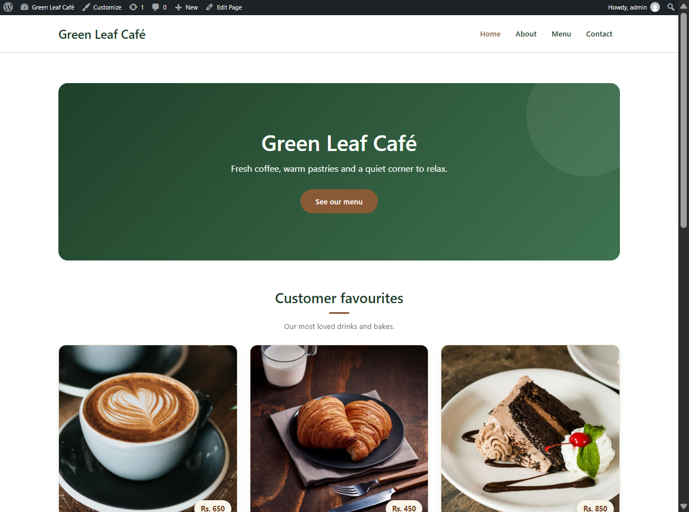
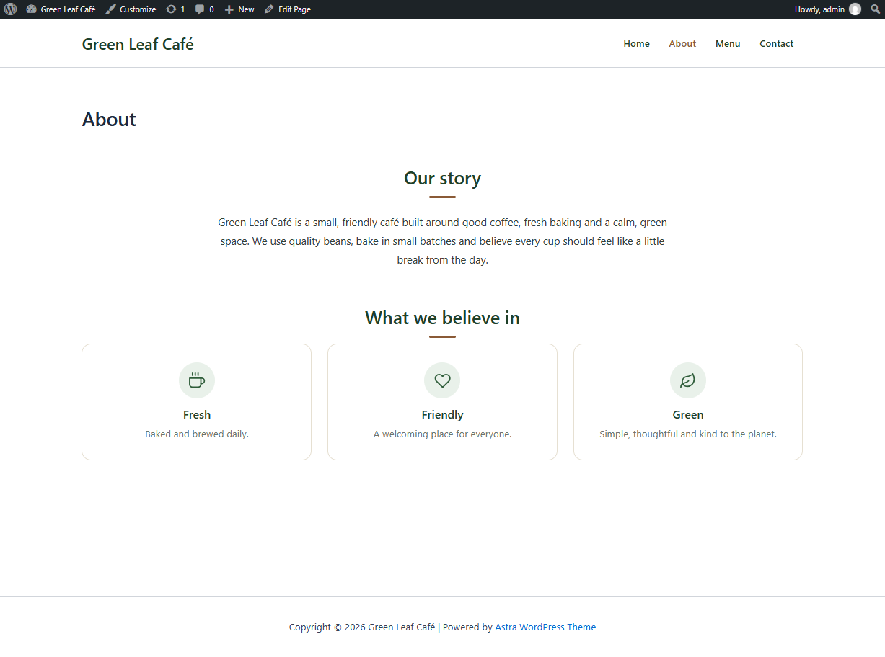
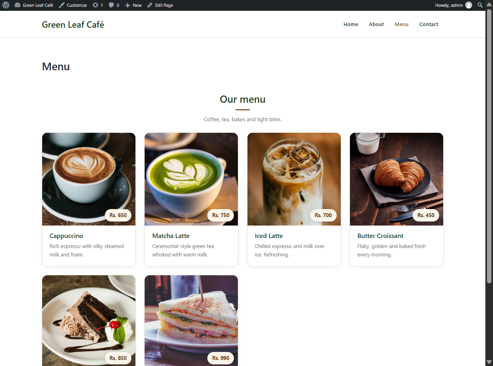
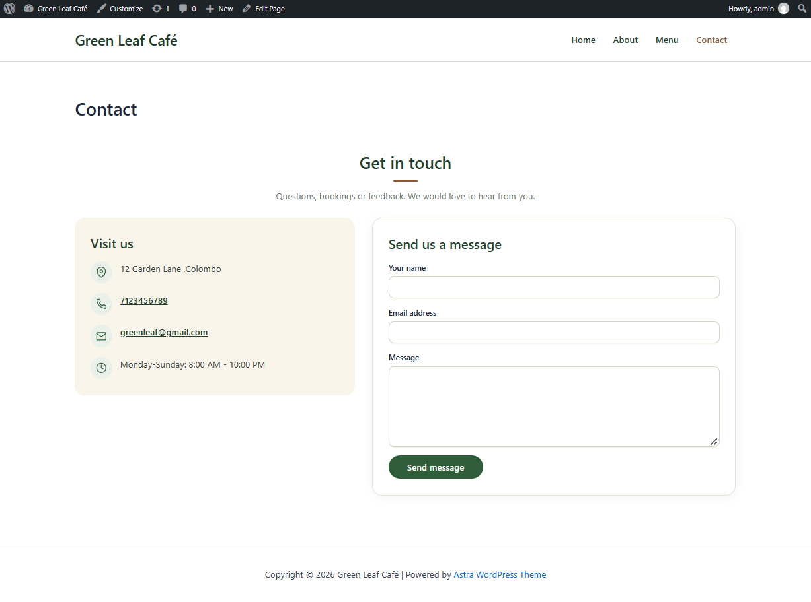

# Green Leaf Café

A responsive café website built with **WordPress**, the **Astra** theme, and a custom PHP plugin. The project includes Home, About, Menu, and Contact pages, with a custom contact form and an admin area for managing café details.

## Website Preview

### Home


### About


### Menu


### Contact


## Features

- Responsive layout with a green-and-cream visual theme
- Home page with a hero section, customer favourites, and opening-hours content
- About page describing the café and its values
- Menu page featuring six food and drink items with descriptions, images, and prices
- Contact page with configurable contact details and a custom message form
- Contact form validation, WordPress nonce verification, input sanitisation, and a hidden spam-trap field
- Submitted messages stored in the WordPress dashboard under **Messages**
- Admin settings for the café address, phone number, email address, and opening hours
- Menu images copied into the WordPress Media Library during plugin activation

## Technologies

- WordPress
- PHP
- CSS
- Astra (free WordPress theme)
- WAMP (local development environment)
- Git and GitHub

## Repository Structure

```text
green-leaf-cafe-main/
├── assets/                         # Café menu images
├── docs/
│   └── screenshots/                # Website screenshots
├── plugin/
│   └── green-leaf-cafe-setup/
│       ├── css/
│       │   └── green-leaf-cafe.css # Custom styling
│       ├── images/                 # Images used by the plugin
│       └── green-leaf-cafe-setup.php
├── .gitignore
└── README.md
```

This repository contains the project-specific plugin, assets, and documentation. It does **not** include a complete WordPress core installation or a database export.

## Local Installation

1. Set up a local WordPress site using WAMP.
2. Install and activate the **Astra** theme.
3. Copy the `green-leaf-cafe-setup` folder into:
   `wp-content/plugins/`
4. In the WordPress dashboard, open **Plugins** and activate **Green Leaf Cafe Setup**.
5. Go to **Settings → Permalinks**, select **Post name**, and save the changes.
6. Open **Settings → Green Leaf Cafe** and enter the café's address, phone number, email address, and opening hours.
7. Visit the website and check the Home, About, Menu, and Contact pages.

> The plugin creates the website pages and navigation menu when activated. If the plugin is already active, deactivate and reactivate it only if you intentionally want to run its setup process again.

## Custom Plugin

The `Green Leaf Cafe Setup` plugin (version 2.0) handles the project-specific website setup and functionality, including page and menu creation, styling, contact details, menu content, and contact message handling.

The contact form uses the `[gl_contact]` shortcode. Contact details and opening hours are displayed through the plugin's shortcodes and are managed from the WordPress settings page.

## Security and Repository Notes

- WordPress configuration files, database dumps, logs, environment files, and uploaded media are excluded through `.gitignore`.
- Do not commit `wp-config.php`, database credentials, private keys, or other secrets.
- Use your own local database and configure WordPress separately.
- Contact form submissions are stored in the site's WordPress database and are not included in this repository.

## Learning Outcomes

This project provided practical experience in building a WordPress website, developing a custom PHP plugin, styling responsive page layouts with CSS, handling form submissions, and maintaining project files with Git and GitHub.
